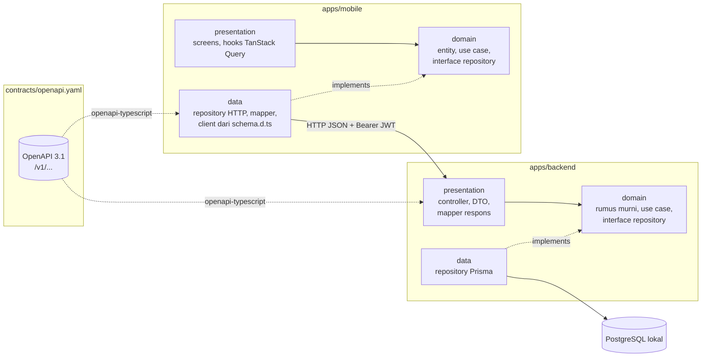
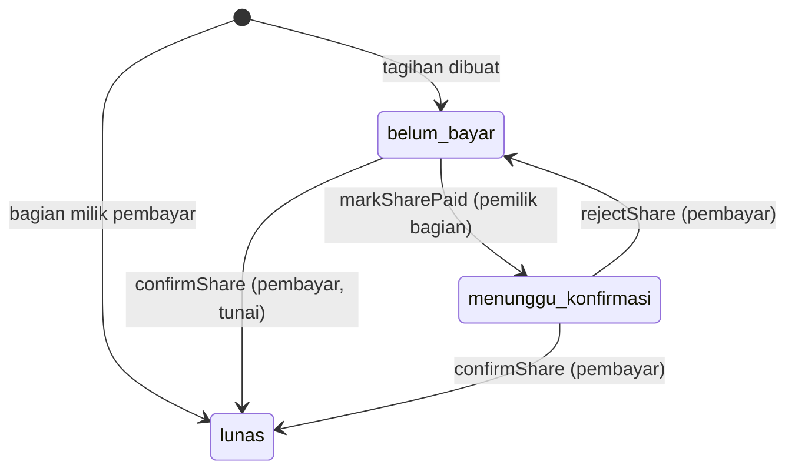

# 02 · Arsitektur: KosKita

> Pemilik dokumen: Bagus (Architect) · Versi 1.1 · 24 November 2026 · Kontrak `info.version` 1.1.0
> Acuan produk: [`docs/01-produk.md`](01-produk.md) · Kontrak API: [`contracts/openapi.yaml`](../contracts/openapi.yaml)

Dokumen ini menetapkan struktur monorepo, pembagian modul, lapisan clean architecture, dan keputusan teknis. **Kontrak API di `contracts/openapi.yaml` adalah hukum**: mobile dan backend mengikutinya persis. Kalau ada celah, tulis di laporan, jangan diakali di kode.

---

## 1. Peta modul

Satu modul = satu area fitur. Nama modul (bahasa Inggris, kebab-case) sama di mobile, backend, dan tag kontrak.

| Modul | Kode produk | Fitur | Endpoint utama (operationId) |
|---|---|---|---|
| `health` | (DevOps) | Cek backend hidup | `getHealth` |
| `auth` | AKN | AKN-01, AKN-02 | `register`, `login`, `refreshTokens`, `logout` |
| `profile` | AKN | AKN-03 | `getMyProfile`, `updateMyProfile` |
| `home` | BRD | BRD-01 | `getHomeToday` |
| `wallet` | DPT | DPT-01 s.d. DPT-04 | `listWalletCategories`, `listTransactions`, `createTransaction`, `getTransaction`, `updateTransaction`, `deleteTransaction`, `getMonthSummary`, `getBudgetStatus`, `setBudget` |
| `split-bill` | PTG | PTG-01 s.d. PTG-04 | `listMyGroups`, `createGroup`, `joinGroup`, `getGroup`, `leaveGroup`, `getGroupBalances`, `listGroupBills`, `createBill`, `getBill`, `deleteBill`, `markSharePaid`, `confirmShare`, `rejectShare` |
| `study` | KLH | KLH-01, KLH-02 | `listSchedules`, `createSchedule`, `getSchedule`, `updateSchedule`, `deleteSchedule`, `listTasks`, `createTask`, `getTask`, `updateTask`, `deleteTask` |

`home` tidak punya tabel sendiri. Use case-nya memanggil interface dari `wallet`, `split-bill`, dan `study`.

## 2. Struktur monorepo

```
super-app/
├── apps/
│   ├── mobile/                      # Expo + expo-router (Dimas)
│   │   ├── app/                     # rute expo-router, file tipis: hanya re-export screen
│   │   │   ├── _layout.tsx          # provider QueryClient + auth gate
│   │   │   ├── (auth)/masuk.tsx, daftar.tsx
│   │   │   ├── (tabs)/_layout.tsx   # 4 tab: Beranda, Dompet, Patungan, Kuliah
│   │   │   ├── (tabs)/index.tsx, dompet.tsx, patungan.tsx, kuliah.tsx
│   │   │   └── ...                  # layar detail/form (transaksi, grup, tagihan, tugas, profil)
│   │   └── src/
│   │       ├── presentation/<module>/   # screens, komponen, hooks TanStack Query
│   │       ├── domain/<module>/         # entity, use case, interface repository (TS murni)
│   │       ├── data/<module>/           # implementasi repository (HTTP), mapper DTO ke entity
│   │       ├── data/api/schema.d.ts     # dibuat openapi-typescript dari kontrak, jangan diedit tangan
│   │       ├── data/api/client.ts       # fetch + bearer + refresh otomatis + parsing ErrorResponse
│   │       └── shared/                  # format Rupiah, tanggal WIB, tema, komponen UI umum
│   └── backend/                     # NestJS (Eko), prisma/ milik Fitri
│       ├── prisma/schema.prisma, migrations/, seed.ts
│       ├── src/
│       │   ├── main.ts              # globalPrefix 'v1', ValidationPipe, filter error
│       │   ├── app.module.ts
│       │   ├── common/              # PrismaService, JwtAuthGuard, @CurrentUser, AppError + filter,
│       │   │                        # Clock (waktu sekarang), helper WIB, cursor pagination
│       │   ├── contract/schema.d.ts # dibuat openapi-typescript, untuk mengetik mapper respons
│       │   └── <module>/
│       │       ├── presentation/    # controller, DTO class-validator, mapper ke respons kontrak
│       │       ├── domain/          # entity, rumus murni, use case, interface repository
│       │       ├── data/            # repository Prisma
│       │       └── <module>.module.ts
│       └── test/                    # e2e Jest + Supertest per modul
├── contracts/openapi.yaml           # Bagus
├── docs/
├── infra/                           # Indah (docker-compose PostgreSQL lokal, dsb.)
└── package.json                     # skrip root (Indah)
```

Nama file rute mobile memakai bahasa Indonesia karena tampil sebagai URL/judul layar; nama folder modul tetap bahasa Inggris.

## 3. Lapisan (clean architecture)



Aturan ketergantungan (arah panah = boleh import):

| Lapisan | Boleh import | Dilarang import |
|---|---|---|
| `domain` | sesama `domain` | `@nestjs/*`, `@prisma/client`, `react`, `react-native`, `expo-*`, `fetch`, `Date.now()` langsung (pakai `Clock`) |
| `data` | `domain`, Prisma / HTTP client, `schema.d.ts` | `presentation` |
| `presentation` | `domain` (use case), DI | Prisma atau `fetch` langsung |

Interface repository didefinisikan di `domain`. Implementasinya di `data`. Penghubungnya: provider NestJS (`{ provide: TRANSACTION_REPOSITORY, useClass: PrismaTransactionRepository }`) di backend, dan satu file `src/data/container.ts` di mobile.

### Rumus murni di domain backend

Rumus yang disebut produk dihitung **hanya di backend**, sebagai fungsi murni yang gampang dites. Mobile cuma menampilkan angka dari kontrak.

| File | Fungsi | Dipakai oleh |
|---|---|---|
| `wallet/domain/daily-allowance.ts` | `calculateDailyAllowance(input: { budget: number; spentBeforeToday: number; spentToday: number; daysLeftIncludingToday: number }): DailyAllowanceResult` | `getBudgetStatus`, `setBudget`, `getHomeToday` |
| `wallet/domain/category-summary.ts` | `summarizeByCategory(rows: { category: Category; amount: number }[]): CategoryTotal[]` (buang 0, urut terbesar, persen `Math.round`) | `getMonthSummary` |
| `split-bill/domain/split-equal.ts` | `splitEqually(total: number, participantIdsByJoinOrder: string[]): { userId: string; amount: number }[]` | `createBill` |
| `split-bill/domain/net-balances.ts` | `computeNetBalances(debts: { from: string; to: string; amount: number }[]): { from: string; to: string; amount: number }[]` (netto hanya per pasangan, satu grup) dan `summarizeForUser(entries, userId): { totalIOwe: number; totalOwedToMe: number; isSettledForUser: boolean }` | `getGroupBalances`, `leaveGroup`, `listMyGroups`, `getHomeToday` |
| `split-bill/domain/bill-deletion.ts` | `canDeleteBill(bill: { createdBy: string; payerId: string; shares: { userId: string; status: ShareStatus }[] }, actorId: string): boolean` (abaikan bagian milik `payerId`) | `deleteBill`, `Bill.canDelete` |
| `split-bill/domain/share-transition.ts` | `nextShareStatus(current: ShareStatus, action: 'mark-paid' \| 'confirm' \| 'reject', actor: 'owner' \| 'payer'): ShareStatus` (lempar `INVALID_SHARE_TRANSITION`) | `markSharePaid`, `confirmShare`, `rejectShare` |
| `split-bill/domain/invite-code.ts` | `createInviteCode(random: () => number): string` (alfabet `ABCDEFGHJKLMNPQRSTUVWXYZ23456789`) | `createGroup` |
| `study/domain/schedule-conflict.ts` | `findConflicts(target, others): ScheduleConflict[]` (irisan `start < other.end && other.start < end`) | semua respons `ClassSchedule` |
| `study/domain/deadline-label.ts` | `deadlineLabel(deadline: Date, status: TaskStatus, now: Date): 'overdue' \| 'due_soon' \| null` | semua respons `StudyTask` |
| `common/time/wib.ts` | `todayWib(now)`, `monthWib(now)`, `daysLeftInMonthWib(now)`, `wibDayOfWeek(now)`, `wibDayRangeUtc(date)` | semua modul |

## 4. Keputusan teknis

| # | Keputusan | Alasan singkat |
|---|---|---|
| K1 | Monorepo tanpa workspace manager; tiap app punya `package.json` sendiri, dipanggil `npm --prefix apps/<app>` | Paling sederhana, sesuai aturan perintah proyek, tidak ada konflik dependency Expo vs NestJS. |
| K2 | Kontrak OpenAPI 3.1 ditulis tangan (contract-first), tipe dibuat dengan `openapi-typescript` ke `apps/mobile/src/data/api/schema.d.ts` dan `apps/backend/src/contract/schema.d.ts` | Satu sumber kebenaran; kalau kontrak berubah, `tsc` di kedua app langsung merah. |
| K3 | Semua path diawali `/v1` (NestJS `setGlobalPrefix('v1')`) | Versi API eksplisit, aman untuk perubahan besar nanti. |
| K4 | Auth: access token JWT 15 menit + refresh token buram 30 hari, dirotasi tiap dipakai, disimpan hash-nya di DB | Sesuai AKN-02 "tetap masuk saat dibuka ulang" dan bisa dicabut saat Keluar; tanpa layanan pihak ketiga. |
| K5 | Hash kata sandi dengan `bcrypt` (cost 10); `password` maks 72 karakter | Batas input bcrypt; library gratis dan umum di NestJS. |
| K6 | Mobile menyimpan token di `expo-secure-store` | Gratis, terenkripsi di perangkat, bawaan Expo. |
| K7 | Mobile: saat dapat `401 TOKEN_EXPIRED`, `client.ts` memanggil `refreshTokens` sekali lalu mengulang request; gagal = hapus sesi, ke layar Masuk dengan pesan "Sesi berakhir, silakan masuk lagi" | Memenuhi kriteria AKN-02 sesi kedaluwarsa. |
| K8 | Uang = integer rupiah (`Int` di Prisma, maks 100.000.000 per nilai); total agregat pakai `BigInt`/`number` aman (< 2^53) | Prinsip produk "Rupiah utuh"; tidak ada floating point. |
| K9 | Waktu: simpan `timestamptz` UTC. Kolom tanggal transaksi = `date` (tanpa jam). Batas hari/bulan selalu dihitung di Asia/Jakarta lewat `common/time/wib.ts` | Aturan lintas modul produk; WIB tanpa DST jadi cukup offset +07:00 tetap. |
| K10 | `Clock` di-inject ke use case (bukan `new Date()` langsung) | Tes rumus jatah harian dan label deadline bisa memakai tanggal tetap, mis. 21 November. |
| K11 | Rumus (jatah harian, bagi rata, saldo netto, label deadline, bentrok jadwal) dihitung backend dan dikirim lewat kontrak | Saran PM; satu implementasi, satu set tes, mobile tidak menghitung ulang. |
| K12 | Paginasi kursor `?cursor=&limit=` (limit 1–100, bawaan 20) untuk transaksi, tagihan, tugas; kursor = base64 dari `(kolom urut, id)` | Stabil saat data bertambah. Grup dan jadwal tanpa paginasi karena kecil (grup ≤ 20 anggota, jadwal mingguan). |
| K13 | Error seragam `{ error: { code, message, details? } }`; 400 = validasi field, 422 = aturan bisnis, 404 untuk data pribadi milik orang lain. Pengecualian: grup/tagihan yang ada tapi saya bukan anggotanya → 403 `NOT_GROUP_MEMBER` | Mobile cukup satu parser error; 404 mencegah bocornya data pribadi. Grup boleh 403 karena ID grup memang dibagikan antar anggota dan pesannya membantu ("kamu bukan anggota grup ini"). |
| K14 | Data grup: cek keanggotaan di use case (`assertMember(groupId, userId)`), bukan di controller | Aturan "hanya anggota" dan "hanya pembayar" berada di domain dan ikut teruji. |
| K15 | Operasi tagihan yang mengubah status bagian dan status tagihan dijalankan dalam satu transaksi Prisma | Status `settled` tidak boleh tertinggal saat bagian terakhir lunas. |
| K16 | Kategori transaksi = enum tetap di kontrak, label Indonesia dari `listWalletCategories` | Kategori bawaan tidak bisa diubah pengguna di MVP; enum mencegah salah ketik. |
| K16a | Dua skema uang: `PositiveRupiah` (1–100.000.000) untuk nilai yang diinput pengguna, `RupiahTotal` (integer ≥ 1, tanpa batas atas) untuk hasil jumlah (`CategoryTotal.amount`, `BalanceEntry.amount`); total yang boleh 0 memakai `Rupiah` (≥ 0) | Batas 100 juta adalah aturan input, bukan batas agregat: dua transaksi Makan Rp60 juta = Rp120 juta tetap sah. |
| K16b | Saldo grup dinettokan **hanya per pasangan dalam satu grup**. Boleh keluar grup hanya jika tidak ada `BalanceEntry` dengan `from`/`to` = saya. `totalIOwe`/`totalOwedToMe` = jumlah entri `from`/`to` = saya; di Beranda dijumlah lintas grup tanpa saling dikurangi | Netto gabungan 0 bisa menyembunyikan utang nyata (A utang B Rp10.000, C utang A Rp10.000): kalau A keluar, utang ke B dan piutang dari C hilang dari catatan. |
| K17 | Status bagian tagihan (`belum_bayar`, `menunggu_konfirmasi`, `lunas`) dan status tugas (`belum`, `selesai`) memakai kata dari dokumen produk; enum lain bahasa Inggris | Mengikuti catatan PM untuk Fitri; satu istilah dari DB sampai layar. |
| K18 | Validasi ganda: Zod di form mobile (pesan langsung di field), class-validator di backend (sumber kebenaran) | AKN-01 minta form salah tidak dikirim; backend tetap tidak percaya klien. |
| K19 | Batasi percobaan `login` dan `register` dengan `@nestjs/throttler` in-memory, balas `429 TOO_MANY_REQUESTS` | Gratis, lokal, mencegah tebak kata sandi. Angka batas diserahkan ke Hendra. |
| K20 | Mobile baca URL backend dari `EXPO_PUBLIC_API_URL` (mis. `http://10.0.2.2:3000` untuk emulator Android, IP LAN untuk HP) | Jalan lokal tanpa cloud; diisi Indah di cara menjalankan. |

## 5. Aturan kontrak yang wajib diikuti

- Ringkasan aturan global ada di bagian `info.description` kontrak. Yang paling sering terlupa:
  - Nominal input `PositiveRupiah` = 1 sampai 100.000.000; desimal atau 0 → `400 VALIDATION_FAILED`. Hasil jumlah memakai `RupiahTotal` (tanpa batas atas) atau `Rupiah` (boleh 0).
  - `date` dan `YYYY-MM` = kalender WIB. `date-time` = UTC dengan akhiran `Z`.
  - Field opsional yang bisa dikosongkan bertipe `string | null`. `null` = hapus nilainya.
  - `PATCH` hanya mengubah field yang dikirim; hasil gabungannya divalidasi seperti `POST`.
- Kode error yang dipakai (selain `VALIDATION_FAILED`, `UNAUTHENTICATED`, `TOKEN_EXPIRED`, `NOT_FOUND`):

| Kode | Status | Dari |
|---|---|---|
| `EMAIL_TAKEN` | 409 | `register` |
| `INVALID_CREDENTIALS` | 401 | `login` |
| `SESSION_EXPIRED` | 401 | `refreshTokens` |
| `TOO_MANY_REQUESTS` | 429 | `login`, `register` |
| `DATE_IN_FUTURE`, `CATEGORY_TYPE_MISMATCH` | 422 | transaksi |
| `MONTH_IN_FUTURE` | 422 | `listTransactions`, `getMonthSummary` |
| `MONTH_NOT_EDITABLE` | 422 | `setBudget` |
| `BUDGET_NOT_FOUND` | 404 | `getBudgetStatus` |
| `GROUP_NOT_FOUND` | 404 | `joinGroup` |
| `GROUP_FULL` | 409 | `joinGroup` |
| `NOT_GROUP_MEMBER` | 403 | `getGroup`, `leaveGroup`, `getGroupBalances`, `listGroupBills`, `createBill`, `getBill`, `deleteBill`, `markSharePaid`, `confirmShare`, `rejectShare`. Tidak dipakai di `listMyGroups`, `createGroup`, `joinGroup` |
| `BALANCE_NOT_SETTLED` | 409 | `leaveGroup` (masih ada `BalanceEntry` dengan `from`/`to` = saya) |
| `MIN_PARTICIPANTS`, `PARTICIPANT_NOT_MEMBER`, `SHARES_SUM_MISMATCH`, `SHARES_REQUIRED`, `SHARES_NOT_ALLOWED` | 422 | `createBill` |
| `NOT_BILL_CREATOR` | 403 | `deleteBill` |
| `BILL_HAS_PAYMENTS` | 409 | `deleteBill` (ada bagian milik peserta **selain pembayar** yang `lunas`; bagian pembayar tidak dihitung) |
| `NOT_SHARE_OWNER` | 403 | `markSharePaid` |
| `NOT_BILL_PAYER` | 403 | `confirmShare`, `rejectShare` |
| `INVALID_SHARE_TRANSITION` | 409 | `markSharePaid`, `confirmShare`, `rejectShare` |
| `TIME_RANGE_INVALID` | 422 | jadwal |
| `SCHEDULE_NOT_FOUND` | 422 | tugas |

- Transisi status bagian tagihan:



- Kontrak hanya diubah Bagus. Cara kerja tim:
  1. Temukan celah → tulis di `laporan.md` (endpoint, field, alasan).
  2. Bagus memperbarui `contracts/openapi.yaml` dan menaikkan `info.version`.
  3. Mobile dan backend membuat ulang tipe:
     - `npx openapi-typescript contracts/openapi.yaml -o apps/mobile/src/data/api/schema.d.ts`
     - `npx openapi-typescript contracts/openapi.yaml -o apps/backend/src/contract/schema.d.ts`
  4. Cek kontrak valid: `npx @redocly/cli lint contracts/openapi.yaml` (3 warning bawaan boleh: tanpa lisensi, server localhost, health tanpa 4xx).

## 6. Rencana implementasi per langkah

Urutan mengikuti `01-produk.md` bagian 10. Tiap langkah berdiri sendiri: bisa dites dan direview tanpa langkah berikutnya.

| Langkah | Pemilik | Hasil | Bukti selesai |
|---|---|---|---|
| 0 | Fitri | `schema.prisma`: `User`, `RefreshToken`, `Transaction`, `Budget` (unik `userId+month`), `Group`, `GroupMember` (unik `groupId+userId`, `joinedAt`), `Bill`, `BillShare` (enum `ShareStatus`), `ClassSchedule`, `StudyTask`; semua nominal `Int` | `npx prisma migrate dev` jalan di PostgreSQL lokal |
| 0 | Indah | `infra/` PostgreSQL lokal + skrip root `dev:backend`, `dev:mobile`, `gen:api` | Backend `GET /v1/health` → `{ "status": "ok" }` |
| 1 | Eko, Dimas | Modul `auth`, `profile`, `common/` (guard, error filter, Clock, WIB) | e2e: daftar → 201, email sama → 409 `EMAIL_TAKEN`, login salah → 401 `INVALID_CREDENTIALS`, refresh dipakai dua kali → 401 `SESSION_EXPIRED`, respons tidak pernah memuat `password`/`passwordHash` |
| 2 | Eko, Dimas | Modul `wallet` | unit `calculateDailyAllowance({ budget: 1500000, spentBeforeToday: 1000000, spentToday: 20000, daysLeftIncludingToday: 10 })` → `dailyAllowance 50000`, `remainingToday 30000`; anggaran terlampaui → `dailyAllowance 0`, `overBudgetAmount > 0`; e2e transaksi tanggal besok → 422 `DATE_IN_FUTURE`; transaksi user lain → 404; dua transaksi Makan 60.000.000 sebulan → `getMonthSummary` `CategoryTotal.amount 120000000` lolos skema |
| 3 | Eko, Dimas | Modul `split-bill` | unit `splitEqually(100000, [a,b,c])` → `[33334, 33333, 33333]`; `computeNetBalances` A→B 70.000 dan B→A 20.000 → satu entri A→B 50.000; **saldo silang:** A→B 10.000 dan C→A 10.000 → dua entri, `summarizeForUser(A)` → `totalIOwe 10000`, `totalOwedToMe 10000`, `isSettledForUser false`, e2e `leaveGroup` oleh A → 409 `BALANCE_NOT_SETTLED`, `GroupSummary` A → `myNetBalance 0`, `isSettledForMe false`; **lintas grup:** A utang 10.000 di grup 1 dan dipiutangi 5.000 di grup 2 → Beranda `totalIOwe 10000`, `totalOwedToMe 5000`; **hapus tagihan:** B membuat tagihan dengan `payerId` = A (bagian A otomatis `lunas`) → `canDelete true` untuk B dan `deleteBill` oleh B → 204; setelah bagian peserta C `lunas` → 409 `BILL_HAS_PAYMENTS`; **agregat:** saldo pasangan > 100.000.000 (dua tagihan 60.000.000 ke orang yang sama) → `BalanceEntry.amount` lolos skema; e2e bukan anggota → 403, manual selisih → 422 `SHARES_SUM_MISMATCH`, konfirmasi oleh bukan pembayar → 403 `NOT_BILL_PAYER`, semua lunas → `status: settled` |
| 4 | Eko, Dimas | Modul `study` | unit jam 10:00–09:00 → `TIME_RANGE_INVALID`; 08:00–10:00 vs 09:00–11:00 hari sama → bentrok, 08:00–10:00 vs 10:00–12:00 → tidak bentrok; deadline kemarin → `overdue`, 23 jam lagi → `due_soon`, 25 jam lagi → `null`, status `selesai` → `null` |
| 5 | Eko, Dimas | Modul `home` | e2e pengguna baru → `budget: null`, `split.hasGroups: false`, array kosong; setelah data ada → angka sama dengan endpoint modul masing-masing; `upcomingTasks` maks 3 |
| 6 | semua | Should (DPT-05, KLH-03, PTG-05) | Hanya setelah 1–5 lolos QA dan review; butuh revisi kontrak dulu |

### Titik rawan untuk direview (Review Focus)

1. **Batas hari WIB.** Pada 1 Desember 00:30 WIB (UTC masih 30 November 17:30), "hari ini" harus 1 Desember dan bulan berjalan `2026-12`: transaksi bertanggal 1 Desember tidak boleh ditolak `DATE_IN_FUTURE`, dan jatah harian memakai anggaran Desember. Tes `todayWib` dan `monthWib` dengan jam ini dan dengan 23:30 WIB.
2. **Hari terakhir bulan.** `daysLeftIncludingToday` pada tanggal 30 November = 1, jatah harian = sisa anggaran penuh; tidak boleh bagi nol.
3. **Bagi rata dengan peserta sebagian.** Sisa Rp1 dibagikan berdasarkan urutan `joinedAt` di grup, bukan urutan array `participantIds` dari klien.
4. **Keluar lalu gabung lagi.** Anggota yang keluar (saldo 0) lalu masuk lagi dengan kode yang sama: tidak membuat duplikat, `joinedAt` baru; tagihan lamanya tetap bisa dibaca anggota lain.
5. **Akses silang.** ID transaksi/jadwal/tugas milik orang lain → 404; `billId` dari grup yang bukan grup saya → 403 `NOT_GROUP_MEMBER` (pengecualian K13). Hendra dan Gilang tolong uji keduanya.

## 7. Yang sengaja tidak masuk MVP

| Tidak masuk | Alasan |
|---|---|
| Tagihan rutin otomatis (DPT-05), pengingat lokal (KLH-03), riwayat tagihan per bulan (PTG-05) | Prioritas Should; kontrak ditambah setelah MVP lolos. |
| Target tabungan (DPT-06), ekspor CSV | Prioritas Could. |
| Lupa kata sandi / verifikasi email | Butuh layanan email; tidak ada yang gratis dan lokal. |
| Login Google, OTP SMS | Butuh layanan pihak ketiga (Won't). |
| Transfer uang, paylater, iklan, chat grup, marketplace | Won't di produk. |
| Push notification server | Butuh layanan push (Expo push = cloud). |
| Mode offline / sinkronisasi | Asumsi produk: butuh koneksi ke backend lokal. |
| Kategori buatan pengguna | Kategori bawaan cukup untuk MVP. |
| Ubah email, hapus akun, kelola anggota oleh admin grup | Tidak diminta di produk. |
| Zona waktu selain WIB | Asumsi produk. |
| Workspace manager (Turborepo/Nx), shared package TS | Belum perlu; tipe bersama cukup lewat file tipe hasil openapi-typescript. |
| Deploy cloud, EAS Build | Aturan proyek: gratis dan lokal saja. |

## 8. Asumsi yang saya ambil

1. Anggaran hanya bisa diatur untuk **bulan berjalan** (`setBudget` bulan lain → 422). Produk bilang "bisa diubah kapan saja di bulan berjalan" dan tidak menyebut bulan depan.
2. `remainingToday` tidak pernah negatif. Kalau hari ini sudah melebihi jatah, kelebihannya ada di `overTodayAmount`. Produk hanya melarang angka negatif untuk jatah harian, jadi aturan yang sama saya terapkan ke sisa hari ini.
3. Persentase kategori dibulatkan dengan `Math.round`, jadi totalnya bisa 99% atau 101%. Ini sesuai produk ("dibulatkan ke bilangan bulat").
4. Kode undangan tidak kedaluwarsa dan tidak bisa diganti di MVP.
5. Menghapus jadwal tidak menghapus tugas; `scheduleId` tugas jadi `null`.
6. `upcomingTasks` di Beranda ikut memuat tugas terlambat (deadline paling dekat = paling lampau, di urutan atas), karena tugas terlambat paling butuh perhatian.
7. Pembayar boleh siapa pun anggota grup, tidak harus peserta. Kalau pembayar ikut jadi peserta, bagiannya langsung `lunas`.
8. Aturan hapus tagihan PTG-02 ("belum ada bagian selain miliknya yang lunas") saya baca sebagai "selain milik **pembayar**", karena bagian pembayar selalu lunas sejak awal. Kalau dibaca "selain milik pembuat", tagihan yang dibayar orang lain tidak akan pernah bisa dihapus.
9. "Saldo Rp0" untuk keluar grup (PTG-01) berarti tidak ada utang maupun piutang per pasangan yang melibatkan saya, bukan netto gabungan 0.

## 9. Catatan untuk peran lain

- **Citra (Desain):** label deadline datang sebagai `overdue` / `due_soon`; teks "Hari ini" atau "Besok" dipilih mobile dari tanggal WIB deadline. Warna status bagian: tiga nilai `ShareStatus`.
- **Fitri (Database):** `Budget.month` simpan sebagai string `YYYY-MM` atau `date` hari pertama, bebas, asal unik per user. `GroupMember` perlu `joinedAt` (urutan bagi rata). Refresh token simpan hash, bukan token asli. `StudyTask.scheduleId` `onDelete: SetNull`.
- **Eko (Backend):** jangan tambah atau ubah field respons di luar kontrak. Mapper respons diketik dengan `components['schemas'][...]` dari `src/contract/schema.d.ts`.
- **Dimas (Mobile):** jangan menghitung ulang jatah harian, bagi rata, atau saldo; tampilkan dari API. Query key TanStack Query per modul; setelah mutasi transaksi/tagihan/tugas, invalidasi juga `['home','today']`.
- **Gilang (QA):** contoh angka di bagian 6 adalah tes minimum. Respons e2e bisa dicek terhadap skema kontrak.
- **Hendra (Keamanan):** perhatikan K4, K13, K14, K19 dan Review Focus no. 5.
- **Indah (DevOps):** butuh skrip `gen:api` (dua perintah openapi-typescript di bagian 5) dan variabel `EXPO_PUBLIC_API_URL`, `DATABASE_URL`, `JWT_ACCESS_SECRET` (nilai lokal acak, bukan rahasia berbayar).
