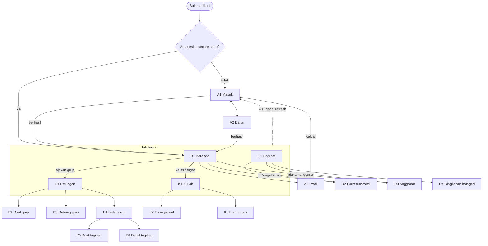
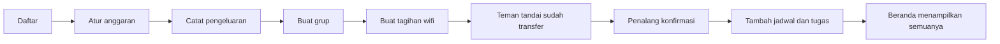
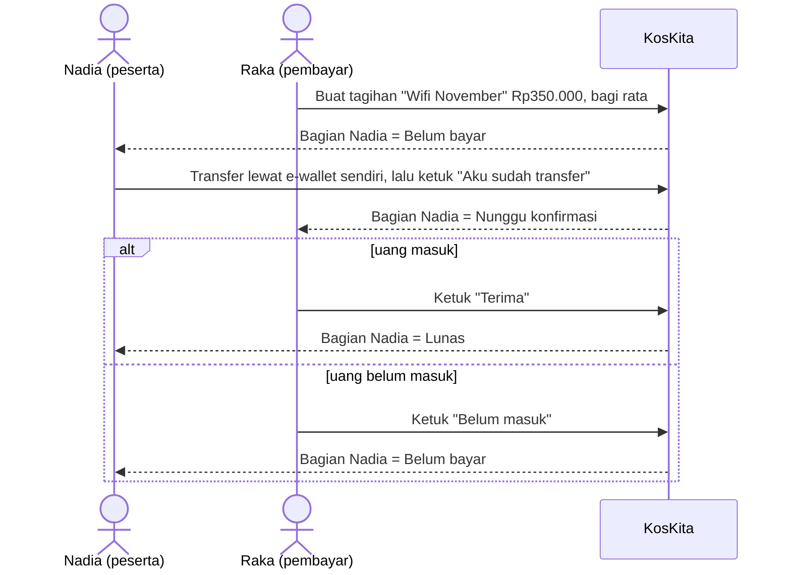

# 03 · Desain: KosKita

> Pemilik dokumen: Citra (Designer) · Versi 1 · 24 November 2026
> Acuan: [`01-produk.md`](01-produk.md) · [`02-arsitektur.md`](02-arsitektur.md) · [`contracts/openapi.yaml`](../contracts/openapi.yaml) (`info.version` 1.1.0)

Dokumen ini menjelaskan alur tampilan semua layar MVP (14 fitur Must): arah visual, design token, user flow, daftar layar, isi dan state tiap layar, komponen, aksesibilitas, dan teks antarmuka. Semua angka (jatah harian, bagi rata, saldo, label deadline, bentrok jadwal) **datang dari API**; layar hanya menampilkan. Nama field di wireframe mengacu ke skema kontrak.

---

## 1. Arah visual: "Meja belajar anak kos"

Bahan visualnya diambil dari meja belajar di kamar kos: **tembok kamar hijau pucat**, **tinta pulpen biru**, dan **stabilo kuning** yang dipakai menandai hal paling penting di catatan kuliah. Bukan nuansa bank (biru korporat, grafik emas) dan bukan nuansa e-commerce (oranye, banner promo), karena KosKita sengaja anti-konsumtif (prinsip produk no. 2).

Prinsip yang dipegang:

1. **Satu sapuan stabilo per layar.** Stabilo kuning hanya dipakai untuk satu angka terpenting di layar itu (contoh: "Sisa hari ini" di Beranda, "Kamu utang" di grup). Kalau semua di-stabilo, tidak ada yang penting. Inilah elemen paling khas KosKita; sisanya tenang.
2. **Angka rupiah adalah tokoh utama.** Angka besar, rata kiri, angka tabular supaya kolom nominal lurus. Label pendek di bawah angka, bukan di atasnya.
3. **Kalimat, bukan kode.** "Kamu utang ke Raka Rp70.000", bukan tabel `from/to/amount`. Status bagian tagihan pakai kata sehari-hari.
4. **Kosong = ajakan.** Modul tanpa data tidak pernah menampilkan "Rp0" yang membingungkan; selalu kalimat ajakan dan satu tombol (BRD-01).
5. **Tanpa dekorasi palsu.** Tidak ada gradien, ilustrasi maskot, atau banner. Struktur dibangun dari jarak, garis tipis, dan ukuran huruf.

Yang sengaja dihindari: kartu seragam dengan bayangan abu-abu di semua tempat, label huruf kapital semua, angka berurutan dekoratif, dan aksen oranye/terakota.

## 2. Design token

Token ditulis untuk `apps/mobile/src/shared/theme/` (Dimas). Nama token bahasa Inggris, sesuai konvensi kode.

### 2.1 Warna

Semua pasangan teks/latar di bawah sudah diukur dengan rumus kontras WCAG 2.2. Teks normal minimal 4,5:1, garis/ikon penting minimal 3:1.

**Mode terang (bawaan)**

| Token | Hex | Nama | Pakai untuk | Kontras |
|---|---|---|---|---|
| `bg` | `#E9F0EC` | Tembok kos | Latar layar | |
| `surface` | `#FFFFFF` | Kertas | Panel, sheet, input | |
| `ink` | `#1A2B4C` | Tinta biru tua | Teks utama, angka | 12,1 (bg) · 14,1 (surface) |
| `inkMuted` | `#4A5873` | Tinta pudar | Teks pendukung, label | 6,2 (bg) · 7,2 (surface) |
| `line` | `#7D8BA3` | Garis buku | Garis input, pemisah penting | 3,5 (surface) |
| `lineSoft` | `#D3DDD7` | Garis tipis | Pemisah dekoratif (bukan info) | |
| `primary` | `#2346A8` | Pulpen biru | Tombol utama, tautan, tab aktif | 8,4 (surface) · 7,2 (bg) |
| `onPrimary` | `#FFFFFF` | | Teks di atas tombol utama | 8,4 |
| `highlight` | `#F7E26B` | Stabilo | Latar sapuan di belakang angka terpenting | ink di atasnya 10,7 |
| `statusPaid` | `#256A43` | Hijau daun | `lunas`, "Selesai", tugas selesai | 6,5 (surface) · 5,6 (bg) |
| `statusPending` | `#8A5A0B` | Kunyit | `menunggu_konfirmasi`, "Hari ini/Besok" | 5,9 (surface) · 5,1 (bg) |
| `statusUnpaid` | `#B23A2E` | Bata | `belum_bayar`, "Terlambat", error, anggaran terlampaui | 5,9 (surface) · 5,1 (bg) |
| `statusPaidSoft` | `#DCEFE3` | | Latar lencana lunas | |
| `statusPendingSoft` | `#F6EAD2` | | Latar lencana menunggu | |
| `statusUnpaidSoft` | `#F7DEDA` | | Latar lencana belum bayar/error | |

**Mode gelap** (ikut setelan sistem lewat `useColorScheme`)

| Token | Hex | Kontras |
|---|---|---|
| `bg` | `#0F1A2E` | |
| `surface` | `#18263F` | |
| `ink` | `#E6ECF5` | 14,6 (bg) |
| `inkMuted` | `#A9B5CA` | 7,3 (surface) |
| `line` | `#6B7E9F` | 3,7 (surface) · 4,2 (bg) |
| `primary` | `#8FB0FF` | 7,1 (surface) |
| `onPrimary` | `#0F1A2E` | 8,1 |
| `highlight` | `#E8D35A` | teks di atasnya tetap `#1A2B4C`: 9,3 |
| `statusPaid` | `#6FCB95` | 7,7 (surface) |
| `statusPending` | `#E9B65A` | 8,1 (surface) |
| `statusUnpaid` | `#FF8A7A` | 6,6 (surface) |

Aturan warna:
- Status **tidak pernah hanya warna**: selalu ada teks lencana ("Belum bayar", "Nunggu konfirmasi", "Lunas") dan ikon bentuk berbeda (lingkaran kosong, jam, centang).
- Teks di atas `highlight` selalu `#1A2B4C` di kedua mode.
- Pemasukan tidak diberi hijau dan pengeluaran tidak diberi merah di daftar transaksi; pembedanya tanda `+`/`−` dan kata. Merah disimpan untuk masalah sungguhan (terlambat, terlampaui, error), supaya tidak bikin cemas tiap jajan.

### 2.2 Tipografi

| Peran | Huruf | Alasan |
|---|---|---|
| Display dan angka besar | **Bricolage Grotesque** (600, 700) | Grotesk dengan karakter sedikit "tulisan tangan rapi", tidak kaku seperti huruf bank. Dipakai hemat: judul layar dan angka utama. |
| Teks isi, label, input | **Atkinson Hyperlegible** (400, 700) | Dirancang untuk keterbacaan tinggi; huruf mirip (I/l/1, O/0) jelas dibedakan. Penting karena kode undangan grup dan nominal rupiah. |

Keduanya gratis (SIL OFL) lewat paket `@expo-google-fonts/bricolage-grotesque` dan `@expo-google-fonts/atkinson-hyperlegible`. Angka nominal memakai `fontVariant: ['tabular-nums']`.

Skala (rasio ~1,25, dasar 16), satuan `sp` supaya ikut ukuran huruf sistem:

| Token | Ukuran / tinggi baris | Huruf | Pakai |
|---|---|---|---|
| `amountXL` | 40 / 44 | Bricolage 700 | Angka stabilo (satu per layar) |
| `title` | 28 / 34 | Bricolage 700 | Judul layar |
| `amountL` | 24 / 30 | Bricolage 600 | Angka ringkasan sekunder |
| `heading` | 20 / 26 | Bricolage 600 | Judul bagian di dalam layar |
| `body` | 16 / 24 | Atkinson 400 | Teks isi, isi daftar |
| `bodyStrong` | 16 / 24 | Atkinson 700 | Nominal di baris daftar, nama |
| `label` | 14 / 20 | Atkinson 400 | Label field, teks pendukung |
| `caption` | 13 / 18 | Atkinson 700 | Lencana status, tanggal kecil |

Huruf kapital semua tidak dipakai. Judul dan tombol memakai huruf kalimat ("Simpan pengeluaran").

### 2.3 Spasi, sudut, bayangan, gerak

| Kelompok | Token |
|---|---|
| Spasi (grid 4) | `xs 4` · `sm 8` · `md 12` · `lg 16` · `xl 24` · `xxl 32` · `xxxl 48` |
| Tepi layar | 20 kiri-kanan (sedikit lebih lega dari 16 supaya angka besar bernapas) |
| Sudut | `r-input 10` · `r-panel 16` · `r-sheet 24` (sisi atas) · `r-pill 999` (lencana, chip) |
| Target sentuh | minimal 48×48 dp, jarak antar target ≥ 8 |
| Bayangan | Hanya untuk tombol mengambang "+ Pengeluaran" dan bottom sheet. Panel lain dibedakan dengan warna `surface` di atas `bg`, tanpa bayangan. |
| Gerak | `fast 150ms` (tekan tombol), `base 220ms` (sheet, centang tugas), easing `out-cubic`. Satu momen khusus: saat transaksi tersimpan, angka stabilo di Beranda menghitung turun ke nilai baru (≤ 400 ms). Semua animasi mati jika `AccessibilityInfo.isReduceMotionEnabled()`. |

Bentuk sapuan stabilo: persegi panjang `highlight` di belakang angka, tinggi 60% dari tinggi huruf, menempel di bagian bawah angka, ujung kiri-kanan sedikit miring (−2°), sudut 4. Dibuat dengan `View` biasa, tanpa gambar.

## 3. Navigasi dan user flow

### 3.1 Struktur navigasi

- **Tumpukan auth** (belum masuk): Masuk, Daftar.
- **Tab bawah** (sudah masuk), 4 tab sesuai saran Rina: Beranda, Dompet, Patungan, Kuliah. Profil dibuka dari tombol avatar di pojok kanan atas Beranda.
- Form tambah/ubah dibuka sebagai layar penuh bergaya modal (geser dari bawah, tombol "Batal" kiri atas). Detail dibuka sebagai layar dorong biasa (tombol kembali).



### 3.2 Alur inti (metrik sukses produk)



### 3.3 Catat pengeluaran dari Beranda dalam 3 ketukan

1. Ketuk **+ Pengeluaran** (tombol mengambang di Beranda). Form terbuka dengan tipe pengeluaran, tanggal hari ini, kursor langsung di kolom nominal, keyboard angka terbuka.
2. Ketik nominal (mengetik angka tidak dihitung ketukan navigasi), lalu ketuk **satu chip kategori**.
3. Ketuk **Simpan pengeluaran**.

Kategori tidak diberi bawaan supaya data tidak bias ke satu kategori; urutan chip mengikuti `listWalletCategories`.

### 3.4 Alur status bagian tagihan (sisi layar)



Tidak ada notifikasi push di MVP (lihat arsitektur bagian 7). Status terbaru terlihat saat layar ditarik untuk muat ulang atau saat layar kembali fokus (TanStack Query `refetchOnFocus`).

## 4. Daftar layar

| Kode | Layar | Rute expo-router (saran) | Fitur | Endpoint |
|---|---|---|---|---|
| A1 | Masuk | `(auth)/masuk` | AKN-02 | `login` |
| A2 | Daftar | `(auth)/daftar` | AKN-01 | `register` |
| A3 | Profil | `profil` | AKN-02, AKN-03 | `getMyProfile`, `updateMyProfile`, `logout` |
| B1 | Beranda | `(tabs)/index` | BRD-01 | `getHomeToday` |
| D1 | Dompet | `(tabs)/dompet` | DPT-02, DPT-03 | `listTransactions`, `getMonthSummary`, `getBudgetStatus` |
| D2 | Form transaksi (tambah/ubah) | `transaksi/baru`, `transaksi/[id]` | DPT-01, DPT-02 | `listWalletCategories`, `createTransaction`, `getTransaction`, `updateTransaction`, `deleteTransaction` |
| D3 | Atur anggaran | `anggaran` | DPT-03 | `getBudgetStatus`, `setBudget` |
| D4 | Ringkasan kategori | `ringkasan/[month]` | DPT-04 | `getMonthSummary` |
| P1 | Patungan (daftar grup) | `(tabs)/patungan` | PTG-01, PTG-04 | `listMyGroups` |
| P2 | Buat grup | `grup/baru` | PTG-01 | `createGroup` |
| P3 | Gabung grup | `grup/gabung` | PTG-01 | `joinGroup` |
| P4 | Detail grup | `grup/[id]` | PTG-01, PTG-04 | `getGroup`, `getGroupBalances`, `listGroupBills`, `leaveGroup` |
| P5 | Buat tagihan | `grup/[id]/tagihan-baru` | PTG-02 | `getGroup`, `createBill` |
| P6 | Detail tagihan | `tagihan/[id]` | PTG-02, PTG-03 | `getBill`, `markSharePaid`, `confirmShare`, `rejectShare`, `deleteBill` |
| K1 | Kuliah (Jadwal / Tugas) | `(tabs)/kuliah` | KLH-01, KLH-02 | `listSchedules`, `listTasks`, `updateTask` (centang) |
| K2 | Form jadwal (tambah/ubah) | `jadwal/baru`, `jadwal/[id]` | KLH-01 | `createSchedule`, `getSchedule`, `updateSchedule`, `deleteSchedule` |
| K3 | Form tugas (tambah/ubah) | `tugas/baru`, `tugas/[id]` | KLH-02 | `listSchedules`, `createTask`, `getTask`, `updateTask`, `deleteTask` |

Total 17 layar. Rute di atas saran; nama file final milik Dimas.

## 5. Pola state bersama

Semua layar data memakai pola yang sama supaya Dimas cukup membuat satu set komponen.

| State | Tampilan | Catatan |
|---|---|---|
| **Memuat pertama** | Kerangka (skeleton) berbentuk persis seperti isi akhir: balok `lineSoft` untuk angka dan baris. Tidak ada spinner layar penuh. | Kerangka berdenyut pelan (opacity 0,5↔1, 1,2 s); diam jika reduce motion. Pembaca layar mendengar "Memuat Beranda". |
| **Muat ulang** | Tarik ke bawah (`RefreshControl`), data lama tetap tampil. | |
| **Muat halaman berikutnya** | Baris "Memuat…" kecil di bawah daftar saat `nextCursor` ada. | Paginasi kursor K12. |
| **Kosong** | Kalimat ajakan 1–2 baris + satu tombol. Tanpa ilustrasi. | Teks per layar ada di bagian 6. |
| **Error jaringan** | Panel `statusUnpaidSoft` di tempat konten: "Tidak bisa tersambung ke server KosKita. Cek koneksi atau pastikan server lokal menyala." + tombol **Coba lagi**. | Data lama dari cache tetap tampil jika ada; panel jadi bilah tipis di atas. |
| **Error validasi (400)** | Pesan di bawah field yang salah (`error.details`), field bergaris `statusUnpaid` dan ikon seru. Fokus pindah ke field salah pertama. | Zod mobile menangkap lebih dulu (K18), jadi 400 jarang muncul. |
| **Error aturan bisnis (403/404/409/422)** | Pesan di atas tombol aksi atau sebagai bilah info di layar, memakai teks dari tabel bagian 9. | |
| **Sesi berakhir** | Kembali ke A1 dengan bilah info "Sesi berakhir, silakan masuk lagi". | K7. |
| **Sedang menyimpan** | Tombol aksi menampilkan teks kerja ("Menyimpan…") dan nonaktif; form tidak dikunci visual. | Mencegah kirim ganda. |
| **Berhasil** | Toast bawah 3 detik dengan kata kerja sama dengan tombol: "Pengeluaran disimpan", "Tagihan dibuat". MVP tanpa tombol urungkan; aksi hapus selalu didahului dialog konfirmasi. | `accessibilityLiveRegion="polite"`. |

## 6. Spesifikasi tiap layar

Notasi wireframe: `[ Tombol ]` tombol, `( chip )` pilihan, `▓▓` sapuan stabilo, `____` input, `⌂ ◫ ⚇ ✎` ikon tab Beranda/Dompet/Patungan/Kuliah.

### A1 · Masuk

```
┌────────────────────────────────┐
│                                │
│  KosKita                       │  ← title, Bricolage
│  Uang bulanan, patungan, dan   │
│  deadline, di satu tempat.     │  ← body, inkMuted
│                                │
│  Email                         │
│  ____________________________  │
│  Kata sandi                    │
│  ________________________ 👁   │  ← tombol tampilkan sandi
│                                │
│  [        Masuk             ]  │  ← primary, lebar penuh
│                                │
│  Belum punya akun? Daftar      │  ← tautan
└────────────────────────────────┘
```

- Isi: email (`keyboardType="email-address"`, `autoComplete="email"`), kata sandi (`secureTextEntry`, `autoComplete="password"`).
- State: **menyimpan** "Masuk…"; **salah** bilah merah di atas tombol "Email atau kata sandi salah" (tidak menyebut field mana); **429** "Terlalu banyak percobaan. Tunggu sebentar lalu coba lagi."; **sesi berakhir** bilah info kuning muda di atas form.
- Berhasil: token disimpan di `expo-secure-store`, ganti tumpukan ke Beranda.

### A2 · Daftar

```
┌────────────────────────────────┐
│ ‹ Masuk                        │
│  Bikin akun                    │
│                                │
│  Nama panggilan                │
│  ____________________________  │
│  Dipakai teman kos di grup.    │  ← helper
│  Email                         │
│  ____________________________  │
│  Kata sandi                    │
│  ________________________ 👁   │
│  Minimal 8 karakter.           │
│                                │
│  [        Daftar            ]  │
└────────────────────────────────┘
```

- Validasi di field (Zod, sebelum kirim): nama 2–50, email valid, sandi 8–72.
- State: **409 `EMAIL_TAKEN`** pesan di bawah field email "Email sudah dipakai"; **429** sama seperti A1.
- Berhasil: langsung masuk ke Beranda (AKN-01). Beranda pengguna baru tampil dengan semua ajakan.

### A3 · Profil

```
┌────────────────────────────────┐
│ ‹ Beranda          Profil      │
│                                │
│  (NR)  Nadia                   │  ← avatar inisial, bukan foto
│        nadia@kampus.ac.id      │
│                                │
│  Nama panggilan                │
│  Nadia_______________________  │
│  Kampus (boleh kosong)         │
│  UGM_________________________  │
│  Email tidak bisa diubah.      │  ← helper di bawah email (read-only)
│                                │
│  [     Simpan profil        ]  │  ← aktif hanya jika ada perubahan
│                                │
│  ──────────────────────────    │
│  Keluar                        │  ← teks statusUnpaid, bukan tombol penuh
└────────────────────────────────┘
```

- Data: `User.name`, `User.email`, `User.campus`.
- State: **memuat** kerangka 3 baris; **error** panel coba lagi; **simpan** toast "Profil disimpan"; kampus dikosongkan dikirim `null`.
- Keluar: dialog "Keluar dari KosKita di HP ini?" [Batal] [Keluar]. Lalu `logout`, hapus secure store, bersihkan cache query, ke A1.

### B1 · Beranda

```
┌────────────────────────────────┐
│  Selasa, 24 November     (NR)  │  ← date WIB · avatar ke Profil
│                                │
│  Sisa jajan hari ini           │  ← label, inkMuted
│  ▓Rp30.000▓                    │  ← amountXL + stabilo (remainingToday)
│  dari jatah Rp50.000 · sisa    │
│  anggaran Rp480.000, 7 hari    │  ← dailyAllowance, remainingBudget,
│                                │    daysLeftIncludingToday
│  ────────────────────────────  │
│  Patungan                      │  ← heading
│  Kamu utang      Rp70.000      │  ← totalIOwe
│  Diutangi        Rp33.333      │  ← totalOwedToMe
│                     Lihat grup │
│  ────────────────────────────  │
│  Kelas hari ini                │
│  08:00–09:40  Statistika  R.204│
│  13:00–14:40  Akuntansi   R.101│
│  ────────────────────────────  │
│  Tugas terdekat                │
│  ○ Laporan praktikum   Terlambat│ ← lencana merah
│  ○ Kuis Statistika     Besok   │ ← lencana kunyit
│  ○ Esai Pancasila      28 Nov  │
│                    Semua tugas │
│                                │
│               [ + Pengeluaran ]│  ← tombol mengambang
├────────────────────────────────┤
│  ⌂ Beranda  ◫ Dompet  ⚇ Patungan  ✎ Kuliah │
└────────────────────────────────┘
```

Satu layar gulir, empat bagian dipisah garis tipis (bukan empat kartu). Data dari satu panggilan `getHomeToday`.

| Bagian | Data | Kosong (ajakan) |
|---|---|---|
| Jatah | `budget.today.remainingToday` (stabilo), `dailyAllowance`, `remainingBudget`, `daysLeftIncludingToday` | `budget = null`: "Belum ada anggaran bulan ini. Atur sekali, nanti kelihatan jatah harianmu." [Atur anggaran] ke D3 |
| Jatah terlampaui hari ini | `overTodayAmount > 0`: angka stabilo Rp0, baris bawah merah "Lewat Rp12.000 dari jatah hari ini" | |
| Anggaran terlampaui | `overBudgetAmount > 0`: angka Rp0 tanpa stabilo, baris merah "Anggaran terlampaui Rp150.000" | |
| Patungan | `split.totalIOwe`, `split.totalOwedToMe` (dua angka terpisah, tidak dinettokan) | `hasGroups = false`: "Patungan wifi atau galon? Buat grup kos atau gabung pakai kode." [Buka Patungan]. Kalau ada grup dan keduanya 0: "Semua patungan beres" dengan ikon centang hijau. |
| Kelas hari ini | `classesToday` (jam, `courseName`, `room`) | "Tidak ada kelas hari ini." Jika jadwal sama sekali belum diisi tidak bisa dibedakan dari Beranda, jadi teksnya netral + tautan "Atur jadwal". |
| Tugas terdekat | `upcomingTasks` (maks 3), lencana dari `deadlineLabel` | "Belum ada tugas yang menunggu." + tautan "Tambah tugas" |

- **Memuat**: kerangka empat bagian. **Error**: panel coba lagi menggantikan seluruh isi, tombol + Pengeluaran tetap ada.
- Mencentang tugas tidak dilakukan di Beranda (target sentuh kecil dan rawan salah ketuk); baris tugas membuka K1 tab Tugas.
- Setelah mutasi transaksi/tagihan/tugas di mana pun, `['home','today']` diinvalidasi (arsitektur bagian 9), lalu angka stabilo beranimasi turun.

### D1 · Dompet

```
┌────────────────────────────────┐
│  Dompet                        │
│  ‹  November 2026  ›           │  ← › nonaktif di bulan berjalan
│                                │
│  Jatah hari ini                │
│  ▓Rp30.000▓  sisa              │  ← hanya bulan berjalan (today ≠ null)
│  Anggaran Rp1.500.000  Ubah    │
│  ████████████░░░░  68% terpakai│  ← bilah totalExpense/amount
│                                │
│  Masuk  +Rp1.500.000           │  ← totalIncome
│  Keluar −Rp1.020.000           │  ← totalExpense
│              Lihat per kategori│  ← ke D4
│  ────────────────────────────  │
│  Hari ini                      │  ← grup tanggal
│  Makan · warteg     −Rp15.000  │
│  Jajan & Hiburan    −Rp5.000   │
│  Senin, 23 Nov                 │
│  Kiriman           +Rp1.500.000│
│  Transport          −Rp12.000  │
│  …                             │
│                 [ + Transaksi ]│
└────────────────────────────────┘
```

- Data: `getBudgetStatus(month)`, `getMonthSummary(month)`, `listTransactions(month)` berhalaman.
- Baris transaksi: label kategori, catatan (dipotong 1 baris), nominal tabular rata kanan dengan `+`/`−`. Ketuk baris membuka D2 mode ubah.
- Bilah anggaran: isi `primary`; jika `overBudgetAmount > 0` bilah penuh `statusUnpaid` + teks "Anggaran terlampaui Rp…".
- Bulan lampau: bagian jatah disembunyikan (`today = null`), anggaran tetap tampil jika ada; tombol Ubah anggaran disembunyikan (`MONTH_NOT_EDITABLE`).

| State | Tampilan |
|---|---|
| Memuat | Kerangka bagian atas + 5 baris |
| Belum ada anggaran (`404 BUDGET_NOT_FOUND`) | Bagian atas diganti ajakan "Atur anggaran bulan ini supaya jatah harian bisa dihitung." [Atur anggaran]. Bulan lampau: "Tidak ada anggaran di bulan ini." tanpa tombol. |
| Tanpa transaksi | "Belum ada catatan di November. Catat pengeluaran pertamamu." [+ Transaksi] |
| Error | Panel coba lagi |

### D2 · Form transaksi (tambah / ubah)

```
┌────────────────────────────────┐
│ Batal      Catat transaksi     │
│                                │
│  ( Pengeluaran )( Pemasukan )  │  ← segmented, 48dp
│                                │
│  Rp ▓15.000▓_________________  │  ← input besar amountXL, keyboard angka
│                                │
│  Kategori                      │
│  ( Makan ) ( Transport )       │
│  ( Kos & Tagihan ) ( Kuliah )  │
│  ( Jajan & Hiburan )( Lainnya )│
│                                │
│  Tanggal                       │
│  Hari ini, 24 Nov          ▾   │  ← date picker, maks hari ini
│  Catatan (boleh kosong)        │
│  warteg depan kos________ 15/100│
│                                │
│  [   Simpan pengeluaran     ]  │  ← teks ikut tipe
│                                │
│  Hapus transaksi               │  ← hanya mode ubah, statusUnpaid
└────────────────────────────────┘
```

- Nominal: hanya angka, pemisah ribuan titik muncul saat mengetik; nilai yang dikirim integer.
- Ganti tipe mengosongkan kategori (kategori berbeda per tipe, mencegah `CATEGORY_TYPE_MISMATCH`).
- Validasi: nominal kosong/0/lebih 100.000.000 "Nominal harus angka rupiah lebih dari 0" (dan "Maksimal Rp100.000.000"); tanggal masa depan tidak bisa dipilih di picker; 422 `DATE_IN_FUTURE` tetap ditangani "Tanggal tidak boleh setelah hari ini".
- Mode ubah: judul "Ubah transaksi", tombol "Simpan perubahan", `404` = "Transaksi ini sudah tidak ada." lalu kembali.
- Hapus: dialog "Hapus pengeluaran Rp15.000?" [Batal] [Hapus]. Toast "Transaksi dihapus".
- Dibuka dari Beranda: tipe pengeluaran terpilih, fokus otomatis di nominal.

### D3 · Atur anggaran

```
┌────────────────────────────────┐
│ Batal    Anggaran November     │
│                                │
│  Berapa jatah pengeluaranmu    │
│  bulan ini?                    │
│                                │
│  Rp 1.500.000________________  │  ← amountXL
│                                │
│  Sudah keluar Rp1.020.000.     │  ← totalExpense (jika ada)
│  Jatah harian langsung dihitung│
│  ulang setelah disimpan.       │
│                                │
│  [     Simpan anggaran      ]  │
└────────────────────────────────┘
```

- Isi awal dari `getBudgetStatus` bulan berjalan (kosong jika 404).
- Berhasil: respons `setBudget` sudah memuat `BudgetStatus` terbaru; kembali dengan toast "Anggaran disimpan, jatah hari ini Rp50.000".
- Error `MONTH_NOT_EDITABLE` tidak terjadi karena layar ini hanya untuk bulan berjalan.

### D4 · Ringkasan kategori

```
┌────────────────────────────────┐
│ ‹ Dompet   Ringkasan November  │
│                                │
│  Total keluar                  │
│  ▓Rp1.020.000▓                 │
│                                │
│  Makan              Rp540.000  │
│  ██████████████████░░░░  53%   │
│  Kos & Tagihan      Rp300.000  │
│  ███████████░░░░░░░░░░░  29%   │
│  Jajan & Hiburan    Rp110.000  │
│  ████░░░░░░░░░░░░░░░░░░  11%   │
│  Transport           Rp70.000  │
│  ███░░░░░░░░░░░░░░░░░░░   7%   │
└────────────────────────────────┘
```

- Data: `expenseByCategory` (sudah urut dan sudah tanpa nol dari API). Bilah horizontal satu warna `primary`, bukan diagram lingkaran: lebih mudah dibandingkan, label tidak berdesakan, dan aman untuk buta warna.
- Persen ditampilkan apa adanya dari API (bisa berjumlah 99% atau 101%, arsitektur asumsi 3).
- Kosong: "Belum ada pengeluaran bulan ini." Bulan bisa digeser seperti D1.
- Bilah punya `accessibilityLabel` "Makan, Rp540.000, 53 persen dari total".

### P1 · Patungan (daftar grup)

```
┌────────────────────────────────┐
│  Patungan                      │
│                                │
│  Kos Pak Darto        5 orang  │
│  Kamu utang Rp70.000           │  ← myNetBalance < 0, teks statusUnpaid
│  ────────────────────────────  │
│  Kontrakan KKN        3 orang  │
│  Diutangi Rp33.333             │  ← myNetBalance > 0, teks ink
│  ────────────────────────────  │
│  Grup Galon           4 orang  │
│  ✓ Beres                       │  ← isSettledForMe, statusPaid
│                                │
│  [ Buat grup ]  [ Gabung pakai kode ] │
└────────────────────────────────┘
```

- Data: `listMyGroups` (`name`, `memberCount`, `myNetBalance`, `isSettledForMe`).
- Teks saldo: `isSettledForMe` → "Beres"; `myNetBalance < 0` → "Kamu utang Rp…"; `> 0` → "Diutangi Rp…"; `= 0` tetapi `isSettledForMe = false` → "Ada utang-piutang, buka grup" (kasus saldo silang K16b).
- Kosong: "Belum ada grup. Buat grup untuk kamar kosmu, atau minta kode dari teman sekos." dengan dua tombol yang sama.

### P2 · Buat grup

```
┌────────────────────────────────┐
│ Batal        Buat grup         │
│  Nama grup                     │
│  Kos Pak Darto_______ 13/40    │
│  [       Buat grup          ]  │
└────────────────────────────────┘
        ↓ berhasil
┌────────────────────────────────┐
│  Grup dibuat                   │
│  Bagikan kode ini ke teman kos │
│                                │
│     ▓ K 7 Q X 2 M ▓            │  ← amountXL, Atkinson, spasi antarhuruf
│                                │
│  [ Salin kode ]  [ Bagikan ]   │  ← Clipboard / Share bawaan RN
│  [       Buka grup          ]  │
└────────────────────────────────┘
```

- Nama 3–40 karakter. Kode dibacakan pembaca layar per karakter ("K, 7, Q, X, 2, M").
- Bagikan memakai `Share.share` bawaan React Native (gratis, tanpa layanan luar) dengan teks "Gabung grup Kos Pak Darto di KosKita pakai kode K7QX2M".

### P3 · Gabung grup

```
┌────────────────────────────────┐
│ Batal       Gabung grup        │
│  Kode grup dari temanmu        │
│  [K][7][Q][X][2][M]            │  ← 6 kotak, autoCapitalize characters
│  [         Gabung           ]  │
└────────────────────────────────┘
```

- Input menerima huruf kecil dan menampilkan huruf besar; karakter O/0/I/1 tetap boleh diketik (backend yang menolak) tetapi diberi petunjuk "Kode tidak memakai huruf O, I atau angka 0, 1".
- Error: `404 GROUP_NOT_FOUND` "Kode grup tidak ditemukan"; `409 GROUP_FULL` "Grup ini sudah penuh (20 orang)". Kode grup yang sudah diikuti: langsung masuk ke grup itu.
- Berhasil: ganti layar ke P4, toast "Kamu bergabung ke Kos Pak Darto".

### P4 · Detail grup

```
┌────────────────────────────────┐
│ ‹ Patungan   Kos Pak Darto  ⋯  │  ← ⋯: lihat kode, anggota, keluar
│                                │
│  Kamu utang                    │
│  ▓Rp70.000▓                    │  ← totalIOwe (stabilo hanya jika > 0)
│  Diutangi Rp33.333             │  ← totalOwedToMe
│                                │
│  Siapa ke siapa                │
│  Kamu utang ke Raka  Rp70.000  │  ← entri yang melibatkan saya dulu
│  Nadia utang ke kamu Rp33.333  │
│  Bima utang ke Raka  Rp70.000  │  ← entri lain, inkMuted
│  ────────────────────────────  │
│  Tagihan   ( Semua )( Belum selesai )( Selesai ) │
│  Wifi November       Rp350.000 │
│  Dibayar Raka · Bagianmu       │
│  Rp70.000  [Belum bayar]       │  ← lencana status bagian saya
│  Galon minggu 4       Rp24.000 │
│  Dibayar kamu  [Selesai]       │
│                                │
│                 [ + Tagihan ]  │
└────────────────────────────────┘
```

- Data: `getGroup` (nama, `inviteCode`, `members`), `getGroupBalances`, `listGroupBills?status=` berhalaman.
- Kalimat saldo dibuat dari `BalanceEntry`: jika `from.userId` = saya → "Kamu utang ke {to.name}"; jika `to.userId` = saya → "{from.name} utang ke kamu"; selain itu "{from.name} utang ke {to.name}". Entri yang melibatkan saya diurutkan di atas.
- `allSettled = true`: bagian saldo diganti "Semua patungan beres" + ikon centang hijau, tanpa stabilo.
- Lencana di baris tagihan: status bagian saya (jika saya peserta), atau "Selesai" jika `status = settled`, atau "Kamu pembayar · 2 dari 5 lunas".
- Menu ⋯: **Kode undangan** (sheet berisi kode + Salin/Bagikan), **Anggota** (daftar `members` urut bergabung, nama + kampus), **Keluar grup**.
- Keluar grup: jika `canLeave = false` item tetap tampil, saat diketuk muncul sheet "Selesaikan dulu patunganmu" + penjelasan singkat siapa yang masih terlibat. Jika `true`: dialog konfirmasi "Keluar dari Kos Pak Darto?" lalu `leaveGroup`. `409 BALANCE_NOT_SETTLED` (data berubah di tengah jalan) ditampilkan dengan teks yang sama.
- `403 NOT_GROUP_MEMBER`: layar diganti "Kamu bukan anggota grup ini lagi." + [Kembali ke Patungan].
- Kosong tagihan: "Belum ada tagihan. Catat tagihan pertama, misal wifi bulan ini." [+ Tagihan]. Grup dengan 1 anggota: tombol + Tagihan diganti ajakan "Ajak minimal satu teman dulu, tagihan butuh 2 orang." [Bagikan kode].

### P5 · Buat tagihan

```
┌────────────────────────────────┐
│ Batal        Tagihan baru      │
│  Judul                         │
│  Wifi November_______ 14/60    │
│  Total                         │
│  Rp 350.000__________________  │
│  Yang bayar dulu               │
│  Kamu                      ▾   │  ← pilih dari members
│  Cara bagi                     │
│  ( Rata )( Manual )            │
│                                │
│  Ikut patungan          5 orang│
│  ☑ Raka            Rp70.000    │  ← pratinjau rata (lihat catatan)
│  ☑ Kamu            Rp70.000    │
│  ☑ Nadia           Rp70.000    │
│  ☑ Bima            Rp70.000    │
│  ☑ Sari            Rp70.000    │
│                                │
│  [      Buat tagihan        ]  │
└────────────────────────────────┘

Mode manual:
│  Raka            Rp 100.000___ │
│  Kamu            Rp  70.000___ │
│  …                             │
│  Terbagi Rp330.000 dari        │
│  Rp350.000 · kurang Rp20.000   │  ← statusUnpaid sampai pas
```

- Urutan peserta mengikuti `members` (urut `joinedAt`).
- Mode rata: centang peserta (bawaan semua, minimal 2). Pratinjau nominal per orang **hanya teks bantu berlabel "kira-kira"**; angka resmi datang dari respons `createBill` (arsitektur K11, mobile tidak menghitung ulang). Tampilkan "± Rp70.000 per orang" bukan per baris, supaya tidak terlihat sebagai angka final saat ada sisa Rp1.
- Mode manual: tiap baris input nominal ≥ 0. Baris ringkasan "Terbagi … dari … · kurang/lebih Rp…" diperbarui saat mengetik; tombol Buat aktif hanya jika pas. Server tetap memvalidasi (`SHARES_SUM_MISMATCH` "Jumlah bagian belum sama dengan total, selisih Rp…").
- Error lain: `MIN_PARTICIPANTS` "Minimal 2 orang ikut patungan"; `PARTICIPANT_NOT_MEMBER` "Ada peserta yang sudah keluar grup. Muat ulang daftar anggota."
- Berhasil: ganti ke P6 tagihan baru, toast "Tagihan dibuat".

### P6 · Detail tagihan

```
┌────────────────────────────────┐
│ ‹ Kos Pak Darto   Wifi November│
│                                │
│  Rp350.000 · bagi rata         │
│  Dibayar Raka · dibuat Raka    │
│  2 dari 5 lunas    [Belum selesai] │
│  ────────────────────────────  │
│  Raka (pembayar)  Rp70.000     │
│  ✓ Lunas                       │
│  Kamu             Rp70.000     │
│  ○ Belum bayar                 │
│  [   Aku sudah transfer     ]  │  ← hanya di baris saya
│  Nadia            Rp70.000     │
│  ◷ Nunggu konfirmasi           │
│  Bima             Rp70.000     │
│  ✓ Lunas                       │
│  Sari             Rp70.000     │
│  ○ Belum bayar                 │
│                                │
│  Hapus tagihan                 │  ← hanya jika canDelete
└────────────────────────────────┘

Dilihat oleh pembayar (Raka), baris Nadia:
│  Nadia            Rp70.000     │
│  ◷ Nunggu konfirmasi           │
│  [ Terima ]  [ Belum masuk ]   │  ← confirmShare / rejectShare
Baris Sari (belum bayar):
│  Sari             Rp70.000     │
│  ○ Belum bayar    Tandai lunas │  ← confirmShare langsung (tunai)
```

| `ShareStatus` | Teks lencana | Ikon | Warna |
|---|---|---|---|
| `belum_bayar` | Belum bayar | ○ lingkaran kosong | `statusUnpaid` di atas `statusUnpaidSoft` |
| `menunggu_konfirmasi` | Nunggu konfirmasi | ◷ jam | `statusPending` di atas `statusPendingSoft` |
| `lunas` | Lunas | ✓ centang | `statusPaid` di atas `statusPaidSoft` |
| Tagihan `settled` | Selesai | ✓ | `statusPaid` |
| Tagihan `open` | Belum selesai | | `inkMuted` garis tepi |

Aksi per peran (tombol hanya muncul jika boleh; aturan tetap diputuskan backend):

| Saya adalah | Status bagian | Aksi |
|---|---|---|
| Pemilik bagian (bukan pembayar) | `belum_bayar` | **Aku sudah transfer** (`markSharePaid`) |
| Pemilik bagian | `menunggu_konfirmasi` | Teks "Menunggu Raka mengecek" |
| Pembayar | `menunggu_konfirmasi` | **Terima** (`confirmShare`), **Belum masuk** (`rejectShare`) |
| Pembayar | `belum_bayar` | **Tandai lunas** (`confirmShare`, untuk tunai), dengan dialog "Tandai bagian Sari Rp70.000 lunas? Pakai ini kalau dibayar tunai." |
| Lainnya | apa pun | Tanpa aksi |

- Setiap aksi: tombol jadi "Menyimpan…", lalu baris diperbarui dari respons `Bill`. Saat bagian terakhir lunas, lencana tagihan berubah "Selesai" dengan animasi centang 220 ms (satu-satunya animasi di layar ini).
- Error: `409 INVALID_SHARE_TRANSITION` "Status bagian ini sudah berubah. Data dimuat ulang." lalu refetch; `403 NOT_SHARE_OWNER` / `NOT_BILL_PAYER` "Hanya {nama} yang bisa melakukan ini."
- Hapus: hanya tampil jika `canDelete`. Dialog "Hapus tagihan Wifi November? Semua bagian ikut terhapus." `409 BILL_HAS_PAYMENTS` "Tagihan tidak bisa dihapus karena sudah ada yang lunas."
- Memuat: kerangka header + 5 baris. 404: "Tagihan ini sudah dihapus." + [Kembali].

### K1 · Kuliah (Jadwal / Tugas)

Satu tab dengan dua segmen di atas. Segmen terakhir dipakai diingat selama aplikasi terbuka.

```
Segmen Jadwal
┌────────────────────────────────┐
│  Kuliah                        │
│  ( Jadwal )( Tugas )           │
│                                │
│  Sen Sel Rab Kam Jum Sab Min   │  ← chip hari, hari ini terpilih
│       ▔▔▔                      │
│  08:00  Statistika             │
│  09:40  R.204                  │
│  ────────────────────────────  │
│  10:00  Ekonomi Mikro          │
│  11:40  R.105                  │
│  ⚠ Bentrok dengan Statistika   │  ← conflictsWith, statusPending
│  ────────────────────────────  │
│                   [ + Jadwal ] │
└────────────────────────────────┘

Segmen Tugas
┌────────────────────────────────┐
│  Kuliah                        │
│  ( Jadwal )( Tugas )           │
│  ( Belum )( Selesai )          │  ← status filter
│                                │
│  ☐ Laporan praktikum           │
│    Kimia Dasar · 22 Nov 23:59  │
│    [Terlambat]                 │  ← overdue
│  ☐ Kuis Statistika             │
│    Statistika · 25 Nov 08:00   │
│    [Besok]                     │  ← due_soon + tanggal WIB besok
│  ☐ Esai Pancasila              │
│    28 Nov 21:00                │
│                    [ + Tugas ] │
└────────────────────────────────┘
```

- Jadwal: `listSchedules` sekali (seminggu penuh), disaring per hari di layar. Hari memakai `DayOfWeek` 1–7 = Sen–Min. Baris: jam mulai dan selesai bertumpuk di kiri (tabular), nama dan ruang di kanan. Ketuk baris membuka K2 mode ubah.
- Peringatan bentrok: jika `conflictsWith` tidak kosong, "Bentrok dengan {courseName}" (beberapa dipisah koma). Warna kunyit, bukan merah, karena boleh disimpan.
- Tugas: `listTasks?status=belum|selesai` berhalaman. Kotak centang 48 dp di kiri, ketuk sekali = `updateTask { status: 'selesai' }` dengan pembaruan optimistis (baris memudar dan keluar 220 ms; jika gagal, kembali + toast "Gagal menandai tugas, coba lagi"). Di segmen Selesai, ketuk centang = kembalikan ke `belum`.
- Lencana deadline: `overdue` → "Terlambat" merah; `due_soon` → "Hari ini" atau "Besok" (dipilih dari tanggal WIB `deadline` dibanding `HomeSummary.date`/tanggal WIB perangkat); `null` → hanya tanggal-jam.
- Kosong: Jadwal hari itu "Tidak ada kelas di hari Sabtu." Jadwal seminggu kosong "Masukkan jadwal kuliahmu sekali, nanti kelas hari ini muncul di Beranda." [+ Jadwal]. Tugas belum "Tidak ada tugas yang menunggu. Mantap." Tugas selesai "Tugas yang kamu centang muncul di sini."

### K2 · Form jadwal

```
┌────────────────────────────────┐
│ Batal        Jadwal baru       │
│  Mata kuliah                   │
│  Statistika__________ 10/60    │
│  Hari                          │
│  (Sen)(Sel)(Rab)(Kam)(Jum)(Sab)(Min) │
│  Mulai          Selesai        │
│  08:00 ▾        09:40 ▾        │  ← time picker 24 jam
│  Ruang (boleh kosong)          │
│  R.204_______________ 5/30     │
│  [      Simpan jadwal       ]  │
│  Hapus jadwal                  │  ← mode ubah
└────────────────────────────────┘
```

- Validasi: nama 2–60; jam selesai harus setelah mulai ("Jam selesai harus setelah jam mulai", juga untuk 422 `TIME_RANGE_INVALID`).
- Setelah simpan: jika respons `conflictsWith` tidak kosong, toast "Jadwal disimpan. Bentrok dengan Statistika." (tetap tersimpan).
- Hapus: dialog "Hapus jadwal Statistika? Tugas yang tertaut tetap ada, hanya tidak lagi punya mata kuliah."

### K3 · Form tugas

```
┌────────────────────────────────┐
│ Batal         Tugas baru       │
│  Judul                         │
│  Kuis Statistika_____ 16/80    │
│  Mata kuliah (boleh kosong)    │
│  Statistika                ▾   │  ← dari listSchedules, unik per nama
│  Deadline                      │
│  Rab, 25 Nov ▾    08:00 ▾      │
│  Catatan (boleh kosong)        │
│  Bab 3–4_____________ 7/300    │
│  [       Simpan tugas       ]  │
│  Hapus tugas                   │  ← mode ubah
└────────────────────────────────┘
```

- Validasi: judul 3–80, catatan ≤ 300. Deadline lampau boleh; muncul teks bantu kunyit "Deadline sudah lewat, tugas akan berlabel Terlambat."
- Picker mata kuliah: opsi "Tanpa mata kuliah" paling atas (kirim `scheduleId: null`). Satu mata kuliah bisa punya beberapa jadwal; tampilkan "Statistika · Sen 08:00" supaya jelas jadwal mana yang ditautkan.
- `422 SCHEDULE_NOT_FOUND`: "Jadwal yang dipilih sudah dihapus. Pilih lagi." dan daftar dimuat ulang.
- Deadline dikirim sebagai UTC (`Z`) dari pilihan tanggal-jam WIB.

## 7. Komponen

Komponen dasar di `apps/mobile/src/shared/ui/`. Semua menerima `testID` untuk tes.

| Komponen | Isi / varian | Dipakai di |
|---|---|---|
| `Screen` | Latar `bg`, tepi 20, `SafeAreaView`, `RefreshControl` opsional | Semua |
| `ScreenHeader` | Judul `title`, aksi kiri (Kembali/Batal) dan kanan | Semua |
| `HighlightAmount` | Angka `amountXL` + sapuan stabilo; prop `animateFrom` | B1, D1, D3, D4, P4 |
| `Amount` | Format `Rp1.500.000` dengan tanda opsional `+`/`−`, tabular; varian ukuran `L`/`body` | Banyak |
| `Button` | `primary`, `secondary` (garis `line`), `text`, `danger-text`; state `loading` dengan teks kerja | Semua |
| `Fab` | Tombol mengambang berlabel teks ("+ Pengeluaran"), bukan ikon saja | B1, D1, P4, K1 |
| `TextField` | Label di atas, helper/penghitung karakter, error di bawah | Form |
| `AmountField` | Prefiks "Rp", pemisah ribuan saat ketik, nilai integer | D2, D3, P5 |
| `Segmented` | 2–3 pilihan, `accessibilityRole="tablist"` | D2, P4, K1 |
| `ChipGroup` | Pilihan tunggal (kategori, hari), `radiogroup` | D2, K1, K2 |
| `DayPicker`, `TimePicker`, `DatePicker` | Membungkus picker bawaan Expo; batas maks tanggal | D2, K2, K3 |
| `StatusBadge` | `belum_bayar`, `menunggu_konfirmasi`, `lunas`, `settled`, `open`, `overdue`, `due_soon` | P4, P6, B1, K1 |
| `ListRow` | Judul, subjudul, nilai kanan, lencana; area sentuh penuh | Daftar |
| `SectionDivider` | Garis `lineSoft` + judul `heading` | B1, D1, P4 |
| `ProgressBar` | Bilah anggaran / kategori; varian `over` | D1, D4 |
| `InviteCode` | Kode 6 huruf berjarak, salin & bagikan | P2, P4 |
| `CodeInput` | 6 kotak, huruf besar otomatis | P3 |
| `TaskCheckbox` | 48 dp, animasi centang, optimistis | K1 |
| `EmptyState` | Kalimat + satu tombol | Semua daftar |
| `ErrorPanel` | Pesan + Coba lagi; varian bilah tipis | Semua |
| `Skeleton` | Balok dan baris, menghormati reduce motion | Semua |
| `Toast` | Bawah, 3 detik, live region | Semua mutasi |
| `ConfirmDialog` | Judul, kalimat akibat, tombol batal + aksi | Hapus, keluar |
| `Avatar` | Inisial 2 huruf dari nama, warna latar dari daftar tetap | A3, B1, P4 |

## 8. Aksesibilitas (WCAG 2.2 AA)

1. **Kontras**: semua pasangan token di 2.1 ≥ 4,5:1 untuk teks dan ≥ 3:1 untuk garis input; `lineSoft` hanya untuk pemisah yang tidak membawa informasi.
2. **Bukan hanya warna**: status selalu teks + ikon (2.1). Nominal masuk/keluar memakai tanda `+`/`−`.
3. **Target sentuh** ≥ 48 dp (melebihi 24 px minimum WCAG 2.5.8).
4. **Ukuran huruf sistem**: semua teks pakai `allowFontScaling`; tata letak diuji di skala 200%. Baris nominal boleh membungkus ke bawah, angka stabilo turun ukuran maksimum 2 tingkat (`maxFontSizeMultiplier` 1,6 untuk `amountXL`).
5. **Pembaca layar**: nominal dibacakan "Rp30.000" sebagai "30 ribu rupiah" lewat `accessibilityLabel`; lencana deadline digabung ke label baris ("Kuis Statistika, deadline besok jam 8 pagi, belum selesai"); tombol ikon selalu punya label; header layar `accessibilityRole="header"`.
6. **Urutan fokus** mengikuti urutan visual; setelah submit gagal, fokus ke field error pertama; toast dan perubahan status diumumkan (`accessibilityLiveRegion`/`announceForAccessibility`).
7. **Gerak**: semua animasi dimatikan saat reduce motion; tidak ada yang berkedip.
8. **Form**: label selalu terlihat (bukan placeholder saja); jenis keyboard dan `autoComplete` sesuai field; error menjelaskan cara memperbaiki.
9. **Waktu**: tidak ada batas waktu di layar mana pun; toast tidak membawa aksi penting.
10. **Mode gelap** mengikuti sistem dengan token terpisah yang juga lolos kontras.

## 9. Teks antarmuka

### 9.1 Kosakata tetap

| Konsep | Kata di layar | Jangan pakai |
|---|---|---|
| `expense` / `income` | Pengeluaran / Pemasukan | Debit / Kredit |
| `remainingToday` | Sisa jajan hari ini | Saldo harian |
| `dailyAllowance` | Jatah hari ini | Limit |
| `totalIOwe` / `totalOwedToMe` | Kamu utang / Diutangi | Hutang (ejaan baku: utang) |
| `payer` | Yang bayar dulu / pembayar | Penalang (terlalu formal di tombol) |
| `markSharePaid` | Aku sudah transfer | Bayar (aplikasi tidak memindahkan uang) |
| `confirmShare` | Terima / Tandai lunas | Approve |
| `rejectShare` | Belum masuk | Tolak |
| Tagihan `settled` | Selesai | Closed |

### 9.2 Kode error ke pesan

| Kode | Pesan |
|---|---|
| `VALIDATION_FAILED` | Pesan per field dari `details` |
| `UNAUTHENTICATED`, `SESSION_EXPIRED` | Sesi berakhir, silakan masuk lagi |
| `INVALID_CREDENTIALS` | Email atau kata sandi salah |
| `EMAIL_TAKEN` | Email sudah dipakai |
| `TOO_MANY_REQUESTS` | Terlalu banyak percobaan. Tunggu sebentar lalu coba lagi. |
| `NOT_FOUND` | Data ini sudah tidak ada. |
| `DATE_IN_FUTURE` | Tanggal tidak boleh setelah hari ini |
| `CATEGORY_TYPE_MISMATCH` | Kategori tidak cocok dengan jenis transaksi |
| `MONTH_IN_FUTURE` | Bulan depan belum bisa dibuka |
| `MONTH_NOT_EDITABLE` | Anggaran hanya bisa diatur untuk bulan ini |
| `BUDGET_NOT_FOUND` | (bukan error) tampilkan ajakan atur anggaran |
| `GROUP_NOT_FOUND` | Kode grup tidak ditemukan |
| `GROUP_FULL` | Grup ini sudah penuh (20 orang) |
| `NOT_GROUP_MEMBER` | Kamu bukan anggota grup ini lagi |
| `BALANCE_NOT_SETTLED` | Selesaikan dulu patunganmu |
| `MIN_PARTICIPANTS` | Minimal 2 orang ikut patungan |
| `PARTICIPANT_NOT_MEMBER` | Ada peserta yang sudah keluar grup. Muat ulang daftar anggota. |
| `SHARES_SUM_MISMATCH` | Jumlah bagian belum sama dengan total, selisih Rp… |
| `SHARES_REQUIRED`, `SHARES_NOT_ALLOWED` | Isi nominal tiap peserta / mode rata tidak memakai nominal manual (seharusnya tidak muncul jika form benar) |
| `NOT_BILL_CREATOR` | Hanya pembuat tagihan yang bisa menghapusnya |
| `BILL_HAS_PAYMENTS` | Tagihan tidak bisa dihapus karena sudah ada yang lunas |
| `NOT_SHARE_OWNER` / `NOT_BILL_PAYER` | Hanya {nama} yang bisa melakukan ini |
| `INVALID_SHARE_TRANSITION` | Status bagian ini sudah berubah. Data dimuat ulang. |
| `TIME_RANGE_INVALID` | Jam selesai harus setelah jam mulai |
| `SCHEDULE_NOT_FOUND` | Jadwal yang dipilih sudah dihapus. Pilih lagi. |
| Jaringan/timeout | Tidak bisa tersambung ke server KosKita. Cek koneksi atau pastikan server lokal menyala. |

### 9.3 Format

- Rupiah: `Rp1.500.000` (tanpa spasi, titik ribuan, tanpa desimal). Tanda: `+Rp…`, `−Rp…` (minus sejati U+2212).
- Tanggal: "Selasa, 24 November" di judul; "24 Nov" di daftar; "Hari ini" dan "Kemarin" untuk dua hari terakhir di daftar transaksi.
- Jam: 24 jam "08:00". Semua tanggal dan jam ditampilkan dalam WIB.
- Bulan: "November 2026".

## 10. Asumsi dan catatan untuk peran lain

### Asumsi desain

1. Kategori tidak punya bawaan di form transaksi (3 ketukan tetap terpenuhi: tombol, chip, simpan).
2. Pratinjau bagi rata di P5 ditampilkan sebagai "± Rp… per orang", bukan angka final per peserta, karena angka resmi dihitung backend (K11).
3. Kelas hari ini di Beranda tidak bisa membedakan "belum isi jadwal" dan "hari ini kosong", jadi teksnya netral + tautan "Atur jadwal".
4. Teks "Hari ini/Besok" untuk `due_soon` dipilih mobile dari tanggal WIB deadline (sesuai catatan Bagus).
5. Mode gelap ikut sistem, tanpa tombol pengaturan di MVP.
6. Huruf memakai paket `@expo-google-fonts` (gratis, lisensi OFL, dibundel di aplikasi).

### Catatan

- **Dimas (Mobile):** token di bagian 2 jadi `shared/theme`; komponen bagian 7 di `shared/ui`. Pesan error pakai tabel 9.2 berdasarkan `error.code`, bukan `error.message` dari server. Animasi angka stabilo dan centang tugas wajib menghormati reduce motion.
- **Bagus (Arsitek), bukan pemblokir:** (a) Beranda tidak bisa membedakan "jadwal kosong sama sekali" vs "tidak ada kelas hari ini"; field seperti `hasSchedules` di `HomeSummary` akan membuat ajakan lebih tepat. (b) Daftar tagihan P4 menampilkan status bagian saya dari `Bill.shares`; ini sudah cukup, tidak perlu field baru. (c) Tidak ada endpoint pratinjau bagi rata; desain sudah menyesuaikan, jadi tidak perlu ditambah.
- **Gilang (QA):** skenario UI yang perlu dites manual: 3 ketukan catat pengeluaran dari Beranda; Beranda pengguna baru (semua ajakan, tanpa Rp0); P1 kasus `myNetBalance 0` tetapi `isSettledForMe false`; tombol aksi P6 per peran; skala huruf 200%; mode gelap.
- **Hendra (Keamanan):** layar tidak pernah menampilkan token; kode undangan hanya terlihat oleh anggota; tombol aksi P6 disembunyikan per peran tetapi otorisasi tetap di backend.
